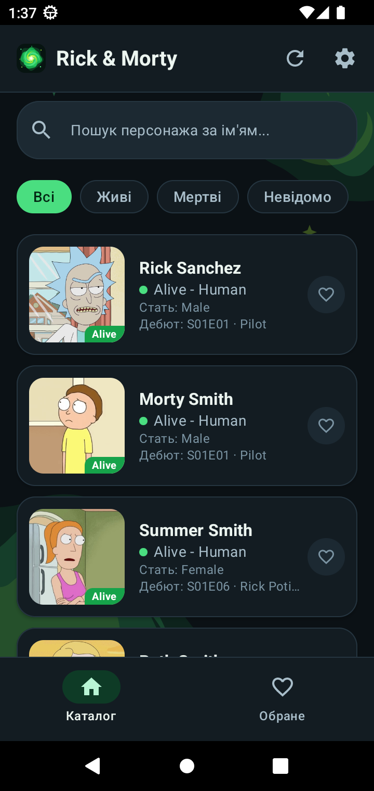
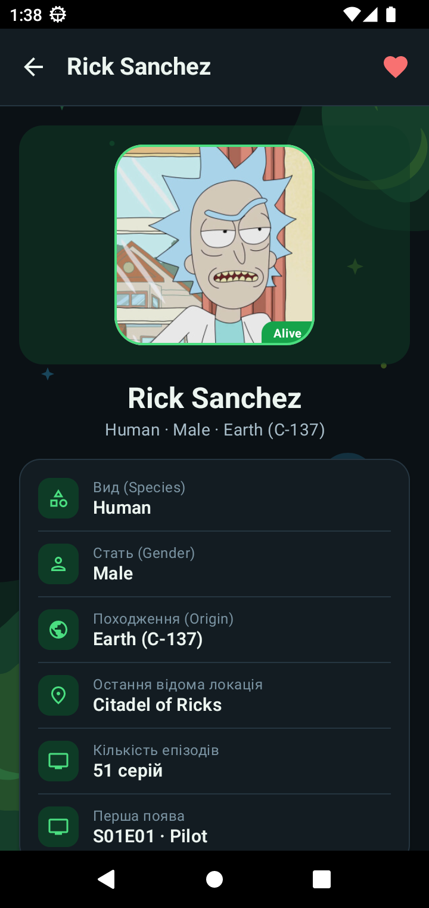
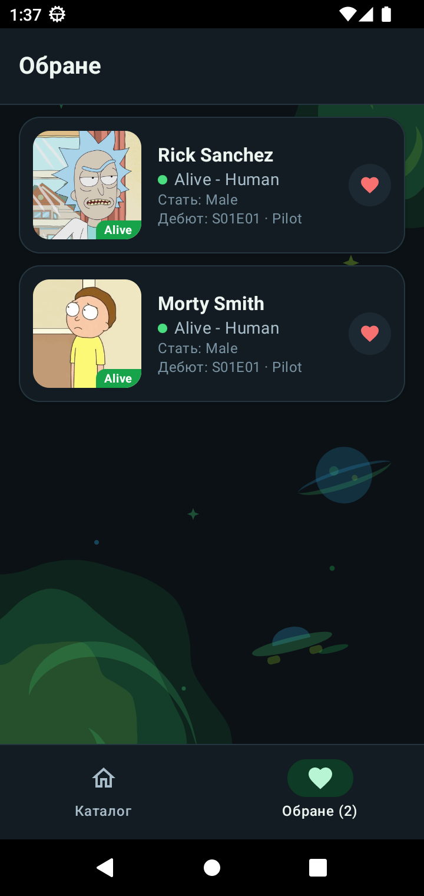
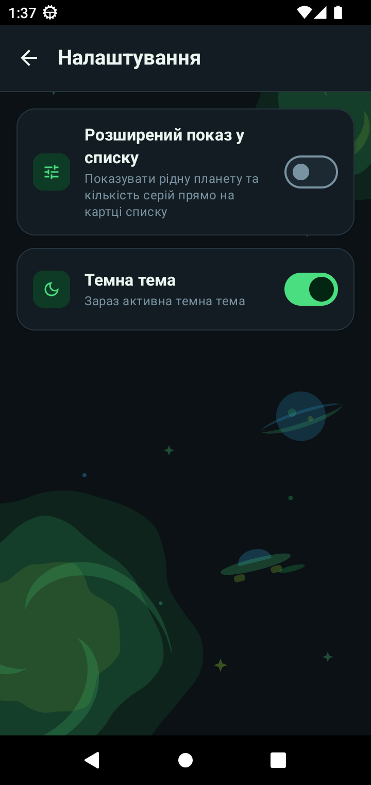
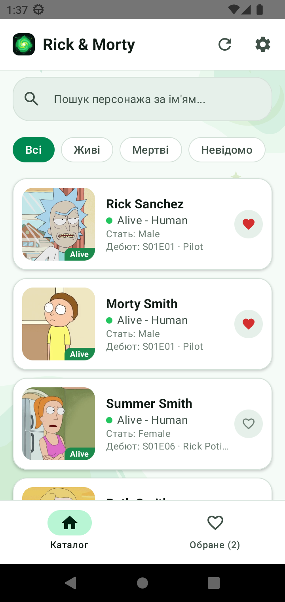

# Rick & Morty Explorer

Android-застосунок для дослідження всесвіту **«Рік та Морті»**, побудований на Jetpack Compose та Material 3 із власною портальною світлою і темною темами, нескінченною пагінацією по всіх 826 персонажах, особистою добіркою в DataStore та експортом досьє героя в Галерею.

## Можливості
- **Каталог усіх 826 персонажів:** автоматичне довантаження сторінок під час прокрутки, оновлення на місці без втрати позиції скролу, пошук за ім'ям і фільтрація за статусом (`Всі`, `Живі`, `Мертві`, `Невідомо`).
- **Детальне досьє:** вид, стать, походження, поточна локація, кількість серій і назва першого епізоду.
- **Особиста добірка («Обране»):** збереження ID обраних героїв у Preferences DataStore із підтягуванням актуальних даних з API після перезапуску.
- **Експорт постера в Галерею:** генерація PNG-картки з фото персонажа та його характеристиками у `Pictures/RickAndMorty`.
- **Налаштування та теми:** перемикач темної/світлої портальної теми, режим розширеного показу деталей на картках списку, кастомна адаптивна іконка та Android 12+ Splash Screen.

## Скріншоти

| Каталог (Dark) | Деталі персонажа | Обране | Налаштування | Каталог (Light) |
| :---: | :---: | :---: | :---: | :---: |
|  |  |  |  |  |

Матеріали для сторінки магазину (короткий і повний описи) винесені у [docs/store-listing.md](docs/store-listing.md).

## Стек технологій
- **Мова:** Kotlin 2.2.10, Coroutines & Flow
- **UI:** Jetpack Compose (BOM `2026.02.01`), Material 3, Navigation Compose, Core SplashScreen (`1.0.1`)
- **Мережа та серіалізація:** Retrofit 2 (`2.11.0`), OkHttp (`4.12.0`), `kotlinx-serialization-json` (`1.9.0`)
- **Зображення:** Coil Compose (`2.7.0`) з обмеженням паралельних запитів і backoff-ретраями для `HTTP 429/503`
- **Локальне збереження:** Jetpack DataStore Preferences (`1.1.1`)
- **Збірка та реліз:** Android Gradle Plugin `9.4.1`, `minSdk = 24`, `targetSdk = 37`, R8 (`isMinifyEnabled = true`, `isShrinkResources = true`)
- **Джерело даних:** публічний REST API [rickandmortyapi.com](https://rickandmortyapi.com/api/character) (без API-ключа)

## Як зібрати

- **Вимоги:** JDK 21, Android SDK (API 37).
- **Параметри `local.properties` (у корені проєкту):**

```properties
sdk.dir=/path/to/android-sdk
RELEASE_STORE_FILE=/path/to/release-keystore.jks
RELEASE_STORE_PASSWORD=your_store_password
RELEASE_KEY_ALIAS=your_key_alias
RELEASE_KEY_PASSWORD=your_key_password
```

- **Команди збірки:**
  - Debug APK: `./gradlew assembleDebug`
  - Release APK: `./gradlew assembleRelease` (`app/build/outputs/apk/release/app-release.apk`)
  - Release AAB: `./gradlew bundleRelease` (`app/build/outputs/bundle/release/app-release.aab`)
  - R8 mapping: `app/build/outputs/mapping/release/mapping.txt`
